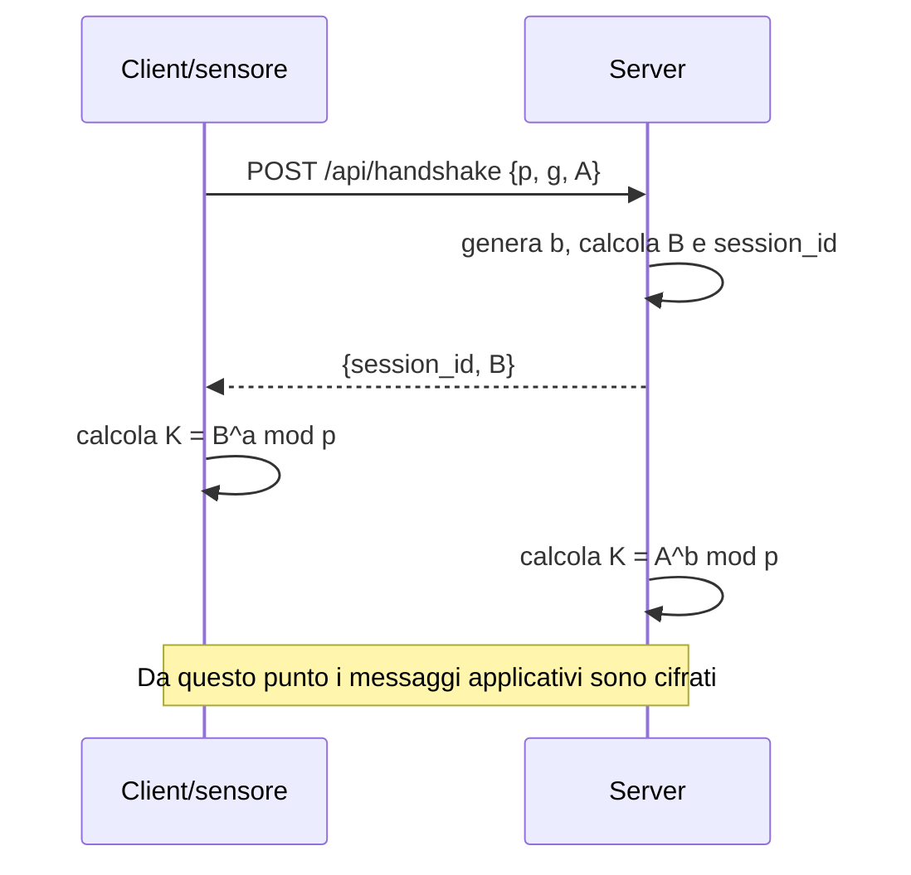

# FrigoTrack Secure Telemetry

Prototipo client-server per la raccolta sicura delle misure di temperatura e
umidità nella catena del freddo. Il progetto simula i sensori installati nelle
celle frigorifere e nei camion di **FrigoTrack S.r.l.** e protegge i dati a
livello applicativo, mantenendo HTTP come protocollo di trasporto.

## Obiettivo

Il sistema deve impedire che le misure viaggino in chiaro o possano essere
modificate senza essere rilevate. Ogni client stabilisce una sessione
indipendente con il server tramite Diffie-Hellman, deriva una chiave condivisa e
usa quella chiave per cifrare le successive richieste e risposte.

Il server:

- espone gli endpoint HTTP del protocollo;
- gestisce più sessioni contemporaneamente;
- decifra e verifica ogni busta prima di elaborarla;
- valida i messaggi con JSON Schema;
- salva le misure ricevute in file JSON;
- genera un allarme quando la temperatura non rientra nell'intervallo
  previsto per il tipo di carico.

Il client simula almeno tre sensori con identificativi distinti, esegue
l'handshake prima di inviare dati e valida localmente ogni misura prima della
cifratura.

## Funzionamento

### 1. Handshake Diffie-Hellman

Il client sceglie i parametri pubblici `p` e `g`, genera il segreto privato
casuale `a` e invia al server:

```text
A = g^a mod p
```

Il server genera il proprio segreto `b`, calcola:

```text
B = g^b mod p
```

e risponde con `session_id` e `B`. Entrambi ricavano quindi lo stesso segreto
condiviso:

```text
K = B^a mod p = A^b mod p
```

Il segreto condiviso viene trasformato nella chiave della sessione. La chiave
non viene mai trasmessa sulla rete; l'unico identificativo trasmesso in chiaro
nelle richieste successive è `session_id`.

Diagramma semplificato:



### 2. Busta cifrata

Ogni messaggio dopo l'handshake è contenuto in una busta JSON:

```json
{
  "session_id": "a3f9c2e1",
  "ciphertext": "mH3t...Base64...==",
  "tag": "8dK2...Base64...=="
}
```

Il server segue sempre questo ordine:

1. cerca la sessione tramite `session_id`;
2. decifra `ciphertext`;
3. verifica `tag`;
4. valida il JSON applicativo con lo schema corretto;
5. elabora la richiesta e produce una risposta cifrata.

Se la sessione non esiste, la busta è manomessa o la validazione fallisce, il
server rifiuta la richiesta senza elaborare i dati.

### 3. Misura di telemetria

Una misura applicativa ha questa forma:

```json
{
  "sensor_id": "CELLA-BG-007",
  "timestamp": "2026-11-02T08:15:30Z",
  "cargo_type": "pharma",
  "temperature_c": 4.6,
  "humidity": 55,
  "battery": 87
}
```

Gli schemi JSON saranno mantenuti separatamente nella cartella `schemas/` e
useranno vincoli espliciti come `required`, `enum`, `minimum`, `maximum`,
`pattern`, `format` e `additionalProperties: false`.

## API prevista

| Metodo | Endpoint | Scopo |
| --- | --- | --- |
| `POST` | `/api/handshake` | Crea una sessione Diffie-Hellman |
| `POST` | `/api/telemetry` | Riceve una misura cifrata e restituisce conferma/allarme |
| `POST` | `/api/readings` | Restituisce le misure di un sensore in un intervallo |
| `POST` | `/api/close` | Chiude la sessione e cancella la chiave |

Il server userà i codici HTTP `200`, `400`, `401` e `404` in base all'esito
dell'operazione.

## Struttura del repository

```text
.
├── client/      # Simulatore dei sensori e gestione delle sessioni
├── data/        # Misure persistite dal server
├── schemas/     # JSON Schema dei messaggi applicativi
├── server/      # API HTTP, sessioni e persistenza
├── tests/       # Test automatici del protocollo e della sicurezza
└── README.md    # Documentazione del progetto
```

## Avvio previsto

L'implementazione sarà sviluppata in Python con dipendenze dichiarate in
`pyproject.toml`. Una volta completata la prima versione:

```bash
python -m venv .venv
source .venv/bin/activate
pip install -e ".[dev]"

# terminale 1
python -m server

# terminale 2
python -m client
```

I comandi definitivi saranno aggiornati insieme al codice eseguibile.

## Piano di verifica

La suite dovrà includere almeno:

1. handshake riuscito e chiavi condivise uguali;
2. invio di un messaggio valido;
3. rifiuto di un messaggio non valido;
4. rifiuto di una busta manomessa;
5. rifiuto di una sessione inesistente.

## Limiti noti del prototipo

Diffie-Hellman garantisce l'accordo sul segreto ma, senza autenticazione
aggiuntiva, non protegge da un attacco man-in-the-middle. Il progetto rispetta
il vincolo didattico di usare HTTP e implementare lo scambio di chiavi a livello
applicativo; non è quindi una sostituzione di HTTPS o di un protocollo
crittografico di produzione. La persistenza iniziale su file JSON è adatta alla
dimostrazione, ma non a carichi elevati o a scenari con più processi server.

## Stato del progetto

Questa repository contiene lo scheletro iniziale e la documentazione del
protocollo. Le componenti server, client, schemi completi e test saranno
aggiunte mantenendo commit piccoli e leggibili, così da rendere chiara la
cronologia del lavoro durante la valutazione pratica.
